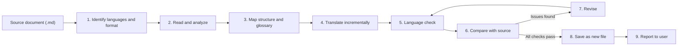

# Translate Any Language

> Translate Markdown documents into any language with an AI agent in Antigravity. No code, scripts, or translation APIs needed: you set the rules once in a guideline file, and the agent follows them every time.

---

## Table of Contents

- [Overview](#overview)
- [Key Features](#key-features)
- [How It Works](#how-it-works)
- [Project Structure](#project-structure)
- [Requirements](#requirements)
- [Getting Started](#getting-started)
- [Usage](#usage)
- [Output Conventions](#output-conventions)
- [Using It as a Skill](#using-it-as-a-skill)
- [Customization](#customization)
- [FAQ](#faq)

---

## Overview

**Translate Any Language** is a guideline-driven translation workflow. You don't write a translation program. The project gives the agent a strict set of rules in [`AGENTS.md`](AGENTS.md), and the agent uses them to:

- keep the original document's structure and Markdown syntax intact,
- keep the meaning without adding or removing content,
- use the same term for the same concept every time,
- compare the translation against the source before finishing, and
- save the result as a separate file, leaving the original untouched.

---

## Key Features

| Feature | Description |
| --- | --- |
| **Any language pair** | Translate between any languages the AI model supports. |
| **Format preservation** | Headings, tables, lists, links, code blocks, front matter, and alerts keep their exact structure. |
| **Protected elements** | Code, URLs, variables, names, and technical identifiers are never translated. |
| **Consistent terminology** | The agent builds a working glossary for each task and reuses terms from earlier translations. |
| **Built-in QA** | The agent compares element counts between source and target before finishing. |
| **Review flags** | Ambiguous terms are marked with hidden `<!-- REVIEW: ... -->` comments. |
| **Non-destructive** | Source files are never modified; translations are saved as new files. |
| **No code required** | Everything runs through natural-language instructions to the agent. |

---

## How It Works



Antigravity automatically loads `AGENTS.md` from the project root as a project rule. Whenever you ask the agent to translate a document here, it follows the guidelines without being reminded.

---

## Project Structure

```text
translate-any-language/
├── AGENTS.md      # Translation guidelines (loaded automatically by the agent)
├── README.md      # Project documentation (this file)
└── docs/          # Put the Markdown documents you want to translate here
```

---

## Requirements

- [Antigravity](https://antigravity.google/) (IDE, 2.0, or CLI) with an AI agent enabled.
- Source documents in **Markdown** format (`.md`), encoded in **UTF-8**.

---

## Getting Started

1. **Clone or copy** this project to your machine.
2. **Open the project folder** as a workspace in Antigravity.
3. **Put your source documents** in the `docs/` folder (subfolders are fine).
4. **Ask the agent** to translate a document (see [Usage](#usage)).

That's it. You don't need to install anything else.

---

## Usage

Type your request in the Antigravity agent chat. Always name the **source file** and the **target language**.

### Translate a single document

```text
Translate docs/guide.md into Indonesian.
```

### Translate several documents

```text
Translate all Markdown files in docs/api/ into Japanese.
```

### Use a custom output name or location

```text
Translate docs/guide.md into Spanish and save it as docs/es/guide.md.
```

### Specify a language variant

```text
Translate docs/guide.md into Brazilian Portuguese (pt-BR).
```

### Overwrite an existing translation

```text
Re-translate docs/guide.md into English and overwrite docs/guide.en.md.
```

> [!TIP]
> You can write requests in any language. For example: `Terjemahkan docs/panduan.md ke bahasa Inggris.`

### What you get back

When the agent finishes, it reports:

1. The source file, source language, target language, and output location.
2. QA results comparing element counts in the source and the target.
3. The key terms and the translations it used.
4. Any sections flagged for review, with reasons.
5. Any internal anchor links it updated.

---

## Output Conventions

Translated files are saved **next to the source file** using this naming pattern:

```text
<file-name>.<language-code>.<extension>
```

| Source document | Target language | Target document |
| --- | --- | --- |
| `docs/guide.md` | Indonesian | `docs/guide.id.md` |
| `docs/panduan.md` | English | `docs/panduan.en.md` |
| `docs/api/intro.md` | Japanese | `docs/api/intro.ja.md` |
| `docs/setup.md` | Chinese (Simplified) | `docs/setup.zh-CN.md` |

Language codes follow **ISO 639-1**, or **BCP 47** when a regional variant matters. Existing files are never overwritten without your confirmation.

### Review flags

When a term is ambiguous, the agent picks the meaning that fits the context and leaves a hidden comment right after it:

```markdown
The system performs a *rollback* if the process fails. <!-- REVIEW: "rollback" kept in English; alternative: "revert to the previous state". -->
```

These comments don't appear in rendered Markdown. To find all of them, search for `REVIEW:` in the translated file.

---

## Using It as a Skill

By default, the guidelines run as a **project rule** through `AGENTS.md`, so they only apply inside this project. If you want to use the same workflow **in other projects** or **only when you ask for it**, package it as an Antigravity **skill**.

### Rule vs. Skill

| | Rule (`AGENTS.md`) | Skill (`SKILL.md`) |
| --- | --- | --- |
| **When loaded** | Always, while working in this project | Only when the request matches the skill's description, or when you name the skill |
| **Scope** | This project only | One project (workspace skill) or all projects (global skill) |
| **Best for** | A dedicated translation project | Translating occasionally from any project |

### Option A — Workspace skill (this project only)

1. Create the folder `.agents/skills/translate-markdown/`.
2. Inside it, create a `SKILL.md` file:

   ````markdown
   ---
   name: translate-markdown
   description: >-
     Use when translating Markdown (.md) documents from one language into another.
     Preserves structure, Markdown syntax, terminology, and meaning, runs a QA
     comparison, and saves the result as a separate file.
   ---

   # Translate Markdown

   Before translating, read `AGENTS.md` in the project root and follow every
   rule, the full Translation Workflow (Steps 1–9), and all Additional Rules.
   ````

This short version points the agent to `AGENTS.md`, so the guidelines stay in one place.

### Option B — Global skill (all projects)

A global skill has to be self-contained, because other projects don't have this `AGENTS.md`.

1. Create the skill folder in your global Antigravity configuration:

   | OS | Path |
   | --- | --- |
   | Windows | `%USERPROFILE%\.gemini\config\skills\translate-markdown\` |
   | macOS / Linux | `~/.gemini/config/skills/translate-markdown/` |

2. Create `SKILL.md` in that folder with the same front matter as Option A.
3. Below the front matter, paste the **full content** of [`AGENTS.md`](AGENTS.md) instead of the short pointer.

### Invoking the skill

Antigravity loads a skill when your request matches its `description`. To be explicit, name the skill:

```text
Use the translate-markdown skill to translate docs/guide.md into French.
```

> [!WARNING]
> If you keep both `AGENTS.md` and a full copy of the guidelines in a skill inside the same project, the agent gets the same instructions twice. If you edit one, update the other or keep only one of them, so the two copies don't drift apart.

---

## Customization

You can adjust the workflow by editing [`AGENTS.md`](AGENTS.md). Common changes:

- **Output location**: save translations in a mirrored folder (for example `translations/<lang>/`) instead of next to the source. Edit *Step 8 — Save*.
- **Spelling variant**: set British instead of American English. Edit *Section 3*.
- **Code comments**: allow comments inside code blocks to be translated. Edit the *Code block* row in *Section 5*.
- **Project glossary**: add a glossary file (for example `GLOSSARY.md`) with approved term pairs. Per *Section 4*, the agent will follow it.

---

## FAQ

**Do I need to write code?**
No. The agent reads the source file, translates it, and writes the new file directly. Code only helps for large-scale automation, such as batch jobs in CI.

**Will the agent change my original documents?**
No. The guidelines forbid modifying, moving, renaming, or deleting source files.

**Which file formats are supported?**
The guidelines are written for Markdown (`.md`), including front matter and embedded HTML. Other text formats may work but aren't covered by the QA checklist.

**What if I don't specify a target language?**
The agent will ask you before it starts.

**How do I keep terminology consistent across many documents?**
Translate related documents into the same language in the same project. The agent checks earlier translations and reuses their terms. For strict control, add a glossary file.

